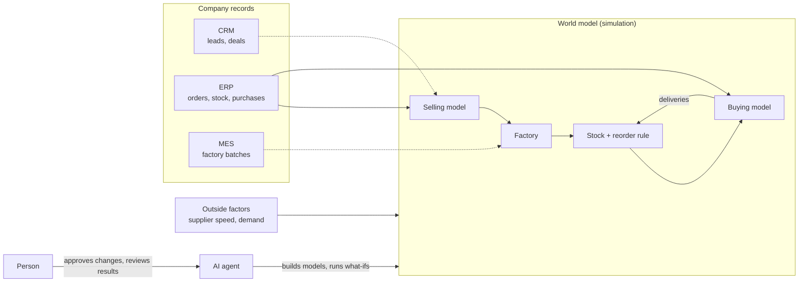

# AutoTwin

**A simulated copy of a company, built from its business records, so you can ask "what if" before changing the real thing.**

Each process (selling, making, buying) becomes a simulation model learned from event logs. The models are linked: customer orders set production, production uses stock, low stock triggers purchases. Change a setting, such as supplier speed, demand or factory capacity, and the whole chain shows the effect. An AI agent builds and runs this, and a person checks the results at key points.

Progress page with charts and plain-language detail: [AutoTwin progress](https://claude.ai/artifact/Nm8sTjHfD2zAus9vZ1wLQV)

## Architecture



Solid arrows exist today. Dotted arrows are planned: there is no CRM or MES data yet, so the factory is a rule we set.

## Status (paint-company example, 14 Oct 2026)

| Part of the vision | Status |
|---|---|
| Linked processes (selling → making → stock → buying) | Done |
| Models learned from event logs | Done, from public and synthetic stand-in logs, not a real company's records |
| What-ifs across the whole chain | Done |
| Outside factors | Started: supplier speed; demand can be scaled |
| AI agent runs it with human checkpoints | Not yet. Built by hand with an AI coding assistant; next step is the product agent reproducing it |
| AI agents playing roles (buyer, planner) | Not yet |

What-ifs over 8 weeks of simulated orders:

| Scenario | Units made / ordered | Avg wait, order → made |
|---|---|---|
| Today | 100,200 / 100,320 | 1.2 days |
| Suppliers 3× slower | 84,000 / 100,320 | 5.6 days |
| Suppliers 3× slower, double safety stock | 100,200 / 100,320 | 1.2 days |
| Sales +30% | 116,312 / 130,416 | 4.5 days |
| Sales +30%, factory capacity +30% | 130,260 / 130,416 | 1.2 days |

A supplier problem travels through stock and production to customers; doubling safety stock cancels it. Every made-up number is listed in `ASSUMPTIONS` at the top of `linked_world.py`.

## Run it

Needs Python 3.12 and [uv](https://docs.astral.sh/uv/). The linked world needs the local model checkpoints under `runs/` (not in the repo).

```sh
uv sync --frozen
uv run python linked_world.py --sales                                        # baseline
uv run python linked_world.py --sales external.supplier_lead_factor=3         # a what-if
uv run python linked_world.py --sales sales.units_per_item=104 max_batch_units=3900
```

Results go to `runs/linked/`. The product agent (terminal chat that builds single-process models from a log) also needs Docker and an OpenRouter key:

```sh
mkdir -p .dcode && cp -n .deepagents/config.example.toml .dcode/config.toml
docker build -t autotwin-worker:local .
uv run python main.py
```

Developer state: `HANDOFF.md` (current steps, assumptions, open issues) and `PROJECT-LOG.jsonl` (full history).
